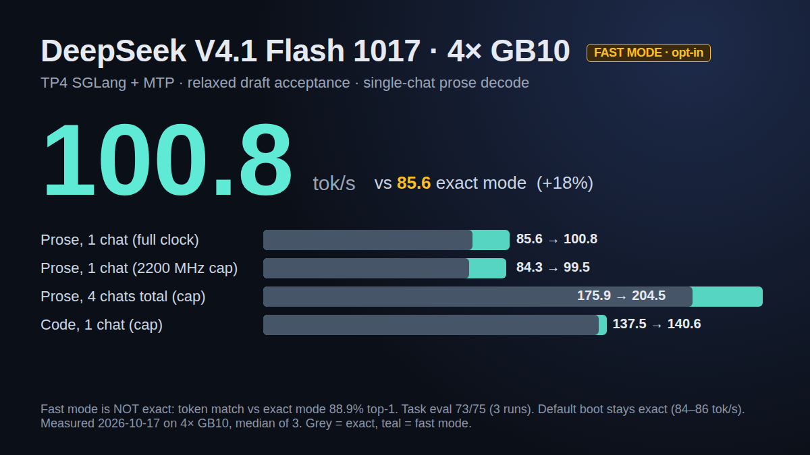

<p align="center"></p>

<h1 align="center">DeepSeek-V4.1-Flash on 4x DGX Spark — tuned TP4 profile</h1>

<p align="center">A measured TP4 serving profile for <a href="https://huggingface.co/deepseek-ai/DeepSeek-V4.1-Flash">deepseek-ai/DeepSeek-V4.1-Flash</a> (native weights, SGLang, DSpark) on four NVIDIA DGX Spark (GB10) nodes, built on top of the MiaAI-Lab recipe.</p>

## Fork notes: DeepSeek-V4.1-Flash-1017

This is a fork of [knapcio/DeepSeek-V4.1-Flash-4x-DGX-Spark-TP4](https://github.com/knapcio/DeepSeek-V4.1-Flash-4x-DGX-Spark-TP4) at `27616be` (v2.4), maintained by Adapt AI Systems on the `1017` branch.
The fork changes the default weights to [deepseek-ai/DeepSeek-V4.1-Flash-1017](https://huggingface.co/deepseek-ai/DeepSeek-V4.1-Flash-1017) @`1bae0e10` and adds measurements on a ring that has one switch hop.
Everything else is knapcio's work and is unchanged. The numbers in "Current results" below are knapcio's, for the old weights on a switched fabric.

- What changed in the weights, the Engram repack step, our boot and the plain-ring results: [`docs/deepseek-v4.1-flash-1017.md`](docs/deepseek-v4.1-flash-1017.md)
- Ring environment we booted from: [`.env.tp4.1017-ring.example`](.env.tp4.1017-ring.example)
- Raw results: [`docs/results/ds1017/`](docs/results/ds1017/)
- Hairpin mesh through one switch hop (software port-role swap, GID fix, test, A/B results): [adapt-ai-systems/gb10-hairpin-ring-switch-hop](https://github.com/adapt-ai-systems/gb10-hairpin-ring-switch-hop)
- Opt-in fast mode (not exact), about 100 tok/s single-chat prose: [Fast mode (not exact)](#fast-mode-not-exact)

Credit for the recipe goes to Mia (MiaAI-Lab), knapcio, and the sparkring authors; see Credits below. The licence is unchanged (AGPL-3.0).

## Fast mode (not exact)

<p align="center"></p>

**Off by default. The default boot stays exact (greedy output identical to the model).** Fast mode changes the output text. Use it at your own risk.

Fast mode relaxes DSpark's greedy acceptance (`adapter/relaxed_accept.py`). The stock rule accepts a draft token only when it is the target's argmax. Fast mode also accepts it when it is close enough to the argmax: with `DSV41_RELAXED_ACCEPT=topp:0.9,ratio:0.1`, the target's probability mass above the draft token must be below 0.9, and the draft token's probability must be at least 0.1 x the argmax's. More drafts are accepted per verify step, so prose decodes faster. Sampled (non-greedy) requests keep the stock rule.

**Turn it on:** in `EXTRA_CONTAINER_ENV`, add `DSV41_RELAXED_ACCEPT=topp:0.9,ratio:0.1` and set `DSV41_CERT_HEAD=0` (`.env.tp4.1017-ring.example` has `DSV41_CERT_HEAD=1`). Fast mode needs the full-vocabulary logits and refuses to start with the certified head on. Rebuild the image (the adapter is copied in at build time) and restart. Every rank logs `[relaxed_accept] ON {'ratio': 0.1, 'topp': 0.9, ...} (NOT EXACT)` and `[relaxed_accept] dspark_verify epilogue rebound`.

**Turn it off:** remove `DSV41_RELAXED_ACCEPT` (or set it to `0`), set `DSV41_CERT_HEAD=1` again, and restart. The `[relaxed_accept]` lines are then absent.

**Status of this build:** the numbers below were measured with the same `relaxed_accept.py` loaded through an outer `sitecustomize` in the same install order. The built-in hook in this repo passes the CPU test and a wiring check, but it has not yet been booted on the cluster. Check for the two log lines above after your first boot.

**Measured** on 2026-10-17 on 4x GB10 with the serve config in [`docs/deepseek-v4.1-flash-1017.md`](docs/deepseek-v4.1-flash-1017.md#serve-config-we-adopted-dual-pci-nccl-plus-hairpin-mesh) (dual-PCI NCCL plus hairpin mesh), sparkDash 1.8.8, 256 new tokens, temperature 0, thinking off, median of 3 runs. The exact rows include the certified head; fast mode runs without it.

| row | exact | fast mode | change |
|---|---:|---:|---:|
| prose c1, full GPU clock | 85.6 | **100.8** | +17.8 % |
| prose c1, 2200 MHz cap | 84.3 | 99.5 | +18.0 % |
| prose c4 aggregate, 2200 MHz cap | 175.9 | 204.5 | +16 % |
| code c1, 2200 MHz cap | 137.5 | 140.6 | +2.3 % |
| structured c1, 2200 MHz cap | 154.9 | 155.2 | +0.2 % |
| prose tokens per verify step (accepted drafts + 1) | 3.12 | 3.76 | +20.5 % |

Code and structured text barely change: their drafts already match the argmax, so there is little left to relax.

**Quality:**
- `scripts/qeval.py` (75 tasks, c1): 73/75 in all 3 runs (exact serve: 71/75).
- `scripts/ds_gate.py kld` against exact-serve collects of the same day: short 0.01269, long 0.00257 (limit 0.035), pass. This check compares the target's distributions on the same prefix, which fast mode does not change, so it cannot see the relaxed tokens.
- **Token fidelity: below our bar.** On fast mode's own greedy continuations of the `ds_gate.py` panels, the share of emitted tokens that are the target's argmax is 88.85 % (short panel) and 88.67 % (long panel). The mean extra negative log-likelihood is 0.1036 and 0.0891 nats per token. Scored the same way, the exact serve gets 98.18 % and 99.41 % and 0.0000. Our bar was 90 % and 0.10, so fast mode fails it. The output leaves the exact output after a median of about 9 tokens.

Test (CPU, no GPU or engine needed): `PYTHONPATH=adapter python3 tests/test_relaxed_accept.py` checks the rule against a copy of the stock greedy rule (ratio 1.0 gives the stock result), the ratio and top-p boundaries, the certified-head refusal and that nothing is patched when the flag is off.

## Credits

This repository is a downstream profile of **[MiaAI-Lab/DeepSeek-v4.1-Flash-DGX-Sparks](https://github.com/MiaAI-Lab/DeepSeek-v4.1-Flash-DGX-Sparks)** by Mia (MiaAI-Lab). The launcher (`start.sh`, `start-tp4.sh`, `boot.py`), the Engram NVMe row store, the MXFP8 b12x routing, the memory model in `docs/chunked-prefill-memory.md`, the thinking alias, the output cap, the loop abort and the overall deployment design are her work, kept here with full git history and under the same licence. The original README is preserved as [`docs/README-upstream.md`](docs/README-upstream.md); read it first for the fleet setup (NFS share, Engram packing, fabric, 3-node profile).

Other work this profile builds on:

- **kpham-sgl**, [sgl-project/sglang#39187](https://github.com/sgl-project/sglang/pull/39187): the bounded dense-indexer prefill transient, backported here as `adapter/indexer_chunked*.py`.
- **BBuf** and the SGLang `dsv4.1` branch contributors ([#39370](https://github.com/sgl-project/sglang/pull/39370), [#39646](https://github.com/sgl-project/sglang/pull/39646), [#39648](https://github.com/sgl-project/sglang/pull/39648), [#39653](https://github.com/sgl-project/sglang/pull/39653)): the decode kernel work in the optional `Dockerfile.canary` image.
- **hushengkai**, for independently reproducing the EP2 / Engram cache / shared-expert padding changes on a second 4x GB10 fleet.
- **rhys101**, [DeepSeek-V4.1-Flash-vLLM-DGX-Spark-8](https://github.com/rhys101/DeepSeek-V4.1-Flash-vLLM-DGX-Spark-8): the SG17 SGLang overlay that routes small tensor-parallel all-reduces to RoCEnante (reused with a TP4 adaptation in `Dockerfile.canary-roce`) and the SG18 native prefill TP split (`adapter/spark_prefill_dense.py`, combined with the indexer backport in `adapter/indexer_chunked_v3.py`).
- **local-inference-lab / Luke Alonso and Jason (original-el8)**, [b12x](https://github.com/local-inference-lab/b12x): RoCEnante, the one-shot RDMA all-reduce (`runtime/b12x`, Apache-2.0, frozen at the SG17 revision), and the fused MoE kernels that run the routed experts (`runtime/b12x_next`: b12x main at `a7d7d29b`, renamed so both revisions live in one image, with a two-line patch that admits 64-row tiles for 576-wide experts at prefill sizes).
- **luxingcom (LuZ)**, [LuZ DGX Spark TP4 ring](https://github.com/luxingcom/LuZ-0.1.7-DeepSeek-v4.1-Flash-DGXspark-TP4-Ring): the first integration of b12x's fused MoE into SGLang on a four-Spark fleet, which showed the route.
- **FujitsuPolycom and the sparkring contributors**, [sparkring](https://github.com/FujitsuPolycom/sparkring): the hardware-forwarded opposite-node paths and the path-aware RoCEnante (`runtime/b12x/b12x/comm/roce_ring`) that run the production line on a switchless ring.
- **rsync** (rchmagos), [#8](https://github.com/knapcio/DeepSeek-V4.1-Flash-4x-DGX-Spark-TP4/pull/8): got RoCEnante running on a four-node switchless ring with sparkring's opposite-node paths and contributed the integration (`DSV41_ROCE_RING`, the `scripts/ring_mesh/` planner).
- **sumsliu**, [dgx-spark-deepseek-v41](https://github.com/sumsliu/dgx-spark-deepseek-v41): the eight-Spark measurement that moving to expert tensor parallelism removes most of the all-reduce wait.
- **Saolence**, [#1](https://github.com/knapcio/DeepSeek-V4.1-Flash-4x-DGX-Spark-TP4/pull/1), [#2](https://github.com/knapcio/DeepSeek-V4.1-Flash-4x-DGX-Spark-TP4/pull/2), [#5](https://github.com/knapcio/DeepSeek-V4.1-Flash-4x-DGX-Spark-TP4/pull/5), [#6](https://github.com/knapcio/DeepSeek-V4.1-Flash-4x-DGX-Spark-TP4/pull/6): the switchless ring as an opt-in switch, the worker NCCL and build fixes, and the first-deployer review in [#4](https://github.com/knapcio/DeepSeek-V4.1-Flash-4x-DGX-Spark-TP4/pull/4) behind the host prerequisites, the download step, the patched-NCCL section and the ring addressing notes.
- **ChrisLou-bioinfo**, **ZackO2o** and **hushengkai** (Mia's repo [#40](https://github.com/MiaAI-Lab/DeepSeek-v4.1-Flash-DGX-Sparks/issues/40), [#41](https://github.com/MiaAI-Lab/DeepSeek-v4.1-Flash-DGX-Sparks/issues/41), [#45](https://github.com/MiaAI-Lab/DeepSeek-v4.1-Flash-DGX-Sparks/issues/45)): the ring recovery notes and the bring-up pitfalls in `docs/switchless-ring.md` and `.env.tp4.example`; the people who published their own measurements are listed in [`docs/community-results.md`](docs/community-results.md).
- **hushengkai** ([Mia #44](https://github.com/MiaAI-Lab/DeepSeek-v4.1-Flash-DGX-Sparks/issues/44), [#9](https://github.com/knapcio/DeepSeek-V4.1-Flash-4x-DGX-Spark-TP4/issues/9), [Mia PR #15](https://github.com/MiaAI-Lab/DeepSeek-v4.1-Flash-DGX-Sparks/pull/15), [#10](https://github.com/knapcio/DeepSeek-V4.1-Flash-4x-DGX-Spark-TP4/issues/10)): the diagnosis of short-request starvation behind chunked prefill (the opt-in `DSV41_PREFILL_BYPASS` adapter is our own implementation, pending fleet qualification), the image-placeholder sanitizer patched into the images, and the offline-load and dead-proxy reports behind `SKIP_PULL` and the proxy pre-check.
- **100menotu001** ([Mia PR #46](https://github.com/MiaAI-Lab/DeepSeek-v4.1-Flash-DGX-Sparks/pull/46), [PR #47](https://github.com/MiaAI-Lab/DeepSeek-v4.1-Flash-DGX-Sparks/pull/47)): public-key recovery and key-blob matching in `ensure_ssh_keys`, the share-before-build error, and Messages `thinking: enabled` without a budget.
- **yalindogusahin** ([Mia PR #4](https://github.com/MiaAI-Lab/DeepSeek-v4.1-Flash-DGX-Sparks/pull/4)), **RustyAiLab** ([PR #5](https://github.com/MiaAI-Lab/DeepSeek-v4.1-Flash-DGX-Sparks/pull/5), [PR #8](https://github.com/MiaAI-Lab/DeepSeek-v4.1-Flash-DGX-Sparks/pull/8)) and **BHCC2025** ([PR #26](https://github.com/MiaAI-Lab/DeepSeek-v4.1-Flash-DGX-Sparks/pull/26)): NFS exporter reuse, the single-rail shell fixes, `remote.py` reading `.env` defaults, and re-sharing before `pack` (GID auto-selection is opt-in here).
- **bertholomus** ([Mia PR #10](https://github.com/MiaAI-Lab/DeepSeek-v4.1-Flash-DGX-Sparks/pull/10)): reading each node's HCA port state, used here as a `doctor` check.
- **motzudao** ([Mia #31](https://github.com/MiaAI-Lab/DeepSeek-v4.1-Flash-DGX-Sparks/issues/31)): the report that a custom `EXTRA_SGLANG_ARGS` dropped the required FP8 GEMM backend.
- **MiaAI-Lab/sparkDash**, the benchmark used for every number below.

## Current results

Production stack v2.4 (the last `EXTRA_CONTAINER_ENV` line of [`.env.tp4.example`](.env.tp4.example) with the v2.4 production block below it, `EP_SIZE=1`, `Dockerfile.canary-roce` image), built from a clean tree on all four nodes, sparkDash 1.8.8: 256 new tokens, temperature 0, thinking off, idle fleet, 2026-10-12. KV pool 3.67M tokens, 1M context. Raw output: [`docs/results/validation-20261012-v24.txt`](docs/results/validation-20261012-v24.txt). Measurements from other fleets are linked, with their dates, in [`docs/community-results.md`](docs/community-results.md).

### sparkDash, GPU clock capped at 2200 MHz

All results here are at the 2200 MHz SM clock cap this fleet runs with (`nvidia-smi -lgc 0,2200`, re-applied by a timer), which keeps the nodes cooler.

**Decode, aggregate tok/s (per stream in brackets)**

| prompt type | c1 | c2 | c4 | c8 | c16 |
|---|---:|---:|---:|---:|---:|
| prose | **89.9** | 123.3 (63.3) | 164.9 (41.7) | 237.2 (30.8) | 341.3 (22.2) |
| code | 131.0 | 175.8 (88.8) | 246.8 (63.2) | 306.8 (41.0) | 440.3 (29.4) |
| structured | 158.7 | 178.9 (103.7) | 240.4 (70.2) | 292.2 (43.5) | 575.6 (44.7) |
| json | 128.4 | 175.1 (90.3) | 314.0 (79.4) | 465.0 (59.4) | 632.8 (41.7) |

**Prefill, cold, tok/s**

| 4k | 16k | 32k | 64k | 128k |
|---:|---:|---:|---:|---:|
| 4756 | 5790 | 5941 | 5969 | 5896 |

**How these were measured.** sparkDash DecodeBench after two discarded warm-up prose c1 runs; c1 is the median of three runs, c4 the median of two, c2 / c8 / c16 one run each. Each cell is the better of two full sweeps on two boots of the same final image (c1 runs: prose 89.9 / 89.0 / 90.0; code 131.0 / 129.3 / 131.4; structured 152.8 / 159.3 / 158.7; json 123.4 / 129.5 / 128.5). This fleet ran without the optional `DSV41_ENGRAM_DRM_NODE` (its display reservation is used by another tenant), which costs a few percent at c8-c16. Prefill: sparkDash prefill bench, cold, one run per length; its filler is one repeated token, so the Engram row cache inflates these numbers ([MiaAI-Lab#21](https://github.com/MiaAI-Lab/DeepSeek-v4.1-Flash-DGX-Sparks/issues/21)).

### Long context and multi-user behaviour

Varied-text prompts, cold (unique salt per prompt), [`scripts/v24_probe.py`](scripts/v24_probe.py):

| | v2.4 |
|---|---:|
| cold prefill, 388K-token prompt | 77.8 s (4,976 tok/s) |
| 969K-token needle (passphrase found) | 235 s |
| short chat sent 8 s into a cold 400K prefill, time to answer | 4.6 s |
| return to a 388K session after a second 388K session ran | 1.5 s (100 % cached) |
| lowest MemAvailable during the 1M prefill, head / workers | 5.7 / 7.1-7.7 GiB |

What v2.4 changed against v2.3 is in [CHANGELOG.md](CHANGELOG.md).

**Quality and correctness gates** (final image, against the v2.3 settings booted the same morning as the reference):

- `scripts/qeval.py` (75 auto-scored tasks, c1, temperature 0): 72 / 72 / 72 on v2.4, the reference 72 / 72 / 72; both miss the same three tasks.
- Greedy-continuation KL against the reference (`scripts/ds_gate.py kld`): mean 0.0045 over 239 positions (long prompts, 16.5k-40k) and 0.0061 over 559 positions (short, 1-3k), PASS against the 0.035 limit.
- T > 0 scan (`ds_gate.py tscan`, 35 outputs): 0 garbled, 0 errors (reference 0 of 35).
- Prefix cache (`scripts/prefix_scan.py`): PASS, cold-vs-warm logprob drift 0.0 on all eight hits (reference identical, including its one false anomaly).
- 60-minute soak at 16 concurrent clients (mixed prompts, T 0 / 0.6 / 1.0, 30 % thinking, ~5 % cold 22K-45K-token prompts): 2,285 completions, 0 errors, 0 empty, 0 container restarts or OOM, 0 kernel Xid / `NV_ERR`, MemAvailable never below 12.9 GiB.
- `/v1/messages` with the image placeholder token in message text and with `thinking: {"type": "enabled"}` without a budget: both answered.

Every earlier measurement, the per-stage tables and the experiments that were tried and not adopted are in [docs/history.md](docs/history.md); what changed when is in [CHANGELOG.md](CHANGELOG.md).

## What runs in production

| Layer | Setting | What it does |
|---|---|---|
| Image | `Dockerfile.canary-roce` | upstream SGLang `dsv4.1` branch at `f80c91a4b` + rhys101's RoCEnante overlay + all adapters |
| Slots | `MAX_RUNNING_REQUESTS=16` | adds the c16 tier |
| Experts | `EP_SIZE=1`, `DSV41_MOE_B12X_NEXT=1`, `DSV41_MOE_B12X_NEXT_DETERMINISTIC=1` | every rank holds a quarter of all 384 experts and the routed MoE runs on b12x main: no expert-group straggler at the MoE all-reduce (all-reduce 5.9 → ~2.6 ms per step), MoE time unchanged. The deterministic reduction (per-slot buffer and a fixed-order sum instead of atomics) costs nothing measurable and makes greedy output bit-identical run to run; its <= 8-row plans use a Triton route planner and zero the barrier words in one fill (bit-identical to b12x's internal planner) |
| Engram | `DSV41_CACHE_GIB=4`, `DSV41_CACHE_WAYS=16`, `DSV41_ENGRAM_PREFETCH=1` | row cache (67–76 % hits) and row lookups on a side stream, rows bit-identical |
| Draft | `DSPARK_BLOCK_SIZE=5`, `SGLANG_DSPARK_FOLDED_SAMPLING=2` | k=5 wins on code, ties on prose; sampled requests stay in the CUDA graph |
| Draft sampling | `DSV41_DRAFT_TAU=0.7`, `DSV41_BLOCK_VERIFY=1` | sharper draft proposals and block verification for sampled rows, both exact in distribution |
| Verify length | `DSV41_VERIFY_CAP=conf:0.1`, `DSV41_ROUTER_LIVE=1` | verifies only the drafts the confidence head expects to survive; the other verify rows reuse the anchor row's experts inside the router kernel, so they read no extra weights; greedy outputs identical |
| Kernels | `DSV41_SHARED_PAD_K=1`, `DSV41_WO_A_W8=1`, `DSV41_WO_A_W8_MID=1`, `DSV41_WO_A_W8_DROP=1`, `DSV41_DRAFT_HEAD_FP8=1` | shared expert kept on the b12x kernel; `wo_a` and the draft LM head read exact fp8 twins of their weights |
| Replicated linears | `DSV41_REPLICATED_SPLIT=wqkv_a,engram.wkv`, `DSV41_DRAFT_MAIN_PROJ_SPLIT=1`, `DSV41_SPLIT_COMPACT_GATHER=1` | layers every rank computed in full are split by columns across ranks and all-gathered; enabled only where bit-identical on all ranks. A rank with a narrower slice runs its GEMM on a window of the widest slice's width, so no pad precedes the gather, and with the compact gather each rank sends only its own columns, which RoCEnante writes in place (no pad, reorder or cat; checked byte for byte against the old path per layer and row count at boot) |
| Transport | `SGLANG_ROCE_ALLREDUCE=1`, `SGLANG_ROCE_MAX_SIZE=2097152`, `DSV41_ROCE_GATHER=2097152`, `B12X_ROCE_HCA=rocep1s0f0,roceP2p1s0f0` | TP all-reduces and all-gathers up to 2 MiB over the one-shot RDMA kernel on both rails |
| Prefill | `CHUNKED_PREFILL_SIZE=8192`, `MEM_FRACTION_STATIC=HEAD_MEM_FRACTION_STATIC=0.78`, `DSV41_INDEXER_CHUNKED=1`, `SPARK_PREFILL_TP_SPLIT=1` | bounded indexer transient (sglang#39187) plus the SG18 row split across ranks from 32k context; 8192-token chunks are 17-28 % faster on 400K-1M cold prompts, and the 0.78 fraction gives back the ~3 GiB the larger chunk costs at 1M (at 0.80 the head dropped to 2.7 GiB available) |
| Multi-user | `--prefill-decode-interval 2`, `DSV41_PREFILL_BYPASS=256` | a short request that arrives during a long cold prefill is admitted next to the in-flight chunk and decoded between chunks: answered in 4.6 s instead of after the prefill (80 s at 400K); the admission adapter only acts after the engine's own memory check and reads only rank-identical state |
| Prefix cache | `--swa-prefix-tails 128` | room for 128 sliding-window prefix tails instead of 64: a long session stays cached when another long session runs (388K revisit 1.5 s instead of an 89 s re-prefill); costs KV pool |
| Loading | `DSV41_FAST_LOAD=1`, `DSV41_FAST_LOAD_TP_SLICE=auto`, `DSV41_AUTOTUNE_KEEP=1` | engine start 343 s → ~120 s; at EP1 each rank reads only its slice of every expert, into 256 MiB pinned slabs (330 allocations instead of ~94k, which gave back ~0.7M tokens of KV pool); MoE autotune cache kept across boots |
| Prefill hc | `DSV41_HC_FUSED=1` | the hyper-connection mix statistics of prefill chunks in one pass over K instead of 80 partial slices: ~1.46 → ~0.83 ms per call at 4096 rows, bit-identical to the stock kernels (checked on the first live call) |
| Prefill sequence parallel | `DSV41_PREFILL_SP=1` | at prefill chunks of >= 2048 rows the per-layer all-reduces become reduce-scatter + all-gather, and the per-row work between them (hyper-connection mixing and norms, the Engram `wkv` projection and gate) runs on each rank's quarter of the rows instead of all four ranks repeating it: prefill ~+20 % from 16k to 262k. Decode is untouched. The partial sums are added in a different order than the all-reduce's (the same kind of change as RoCEnante); `DSV41_PREFILL_SP_EXACT=1` keeps the all-reduce and is bit-identical to the unsharded path (checked op by op on the fleet) for ~+10 %. `DSV41_PREFILL_SP_FP8=1` gathers the attention input of 17 of the 21 full-row layers as the MXFP8 bytes and scales `wqkv_a` would compute itself (checked bit-identical per chunk size on every rank): about half the gather bytes there, +1.5-3 % prefill |
| L2 prefetch | `DSV41_L2_PREFETCH=1`, `DSV41_L2_PREFETCH_WOA=1` | during each RoCE all-reduce and all-gather of a decode step (SMs and DRAM mostly idle for 15-30 us) a side-stream kernel prefetches the first 6 MB of the weights that follow into L2; plans are learned from the warm-up forwards and captured in the CUDA graphs. Data is untouched (outputs bit-identical); decode step -1 ms at c1, +3 % on varied prompts, flat at c16. `WOA` adds a window after `wq_b` that prefetches `wo_a` while the attention core runs: -0.4 ms/step |
| Decode-step sync | `DSV41_SPEC_SYNC_FREE=all` | drops the per-step rank-0 broadcasts whose values are already identical on every rank (the draft token of each Markov step, the verify epilogue's three, verify_cap's live length); the draft noise comes from a counter-based stream every rank computes alike. Audit mode counted 0 rank mismatches in ~60k checks; greedy output byte-identical; -0.53 to -0.59 ms/step in an in-boot A/B (~-0.2 ms across reboots) |
| Decode-step glue | `DSV41_EAGER_GLUE=all` | fewer eager kernels between the draft and verify CUDA graphs (the folded fence's six copies as one, sampling-param staging skipped while unchanged, verify_cap's update inside the draft graph as one kernel); bit-identical, ~-0.1 to -0.2 ms/step |
| Target LM head | `DSV41_CERT_HEAD=1`, `DSV41_CERT_HEAD_M=6,...,48` | greedy verify steps read an 8-bit (MXINT8) screen of the head shard (173 MB instead of 331 MB per rank) with a proven error bound, and compute exactly only the 16-row head tiles that can hold the argmax; the argmax is the stock one (exact kernel bit-identical to the stock matmul, 0 mismatches over 3,355 checked steps), and sampled rows, logprobs, grammar and penalties get the full exact logits. -0.5 ms per c1 step; slower from 10 requests up, so it stops at 8 (M = 48 verify rows); +173 MB per rank |
| Correctness | `DSV41_FOLDED_FENCE=1` | closes the sglang#40919 D2H race on the folded verify path |
| Request guard | `DSV41_REPLAY_GUARD` (default on) | the launch runs SGLang's decoder SWA bounded replay (late layers see only the last window of a prefill), which cannot return prompt-token logprobs; such a request (`/generate` with `logprob_start_len` below the prompt length, `/v1/completions` with `echo` + `logprobs`) used to raise inside the forward and end every rank. It now gets HTTP 400 and the server keeps serving |
| Serving | `--enable-cache-report`, `--sleep-on-idle`, `SGLANG_RUST_BUILD_MODE=never` | cached-token usage for clients, idle CPU 47 % → 14 %, avoids a `cargo` hang at start |
| Optional | `DSV41_ENGRAM_DRM_NODE=/dev/dri/card0` | one Engram layer's cache in the GB10 display reservation, ~1.8 GiB more headroom; needs a host change ([docs/display-reserve.md](docs/display-reserve.md)) |

Not used: `DSV41_ADAPTIVE_CHUNK` (superseded by the bounded indexer), `DSPARK_SPS_TABLE` (crashes the Engram path), the NVFP4 checkpoint (no bandwidth saved on GB10). Each adapter is described in [docs/adapters.md](docs/adapters.md); the measured effect of each switch is in [docs/history.md](docs/history.md#production-stack-as-of-2026-09-24-with-the-full-rationale-per-switch).

## What this profile changes

Relative to the upstream TP4 example, all of it in `.env.tp4.example` plus gated adapters:

| Setting | Upstream | Here | Why (measured) |
|---|---|---|---|
| `EP_SIZE` | 4 | **1** | On the production image (`DSV41_MOE_B12X_NEXT`): every rank streams a 576-wide slice of every touched expert, so no expert group waits for the other at the MoE all-reduce. The base and canary images stay at `EP_SIZE=2` (FlashInfer's MXFP4 MoE needs the per-rank width to be a multiple of 128), which already halves the EP4 straggler wait: NCCL time per step 16.5 → 10.2 ms |
| `DSV41_CACHE_GIB`/`WAYS` | 0/4 | **4/16** | Engram rows do repeat (bigram/trigram heads): 67–76 % hit rate, 4x fewer NVMe reads; 16 ways are free |
| `--min-free-slots-delay 1` | on | on | Without it the admission delayer never fills the last slot |
| `--enable-deepseek-v4-fp4-indexer` | off | on | no effect on V4.1: the model has no ratio-4 layers and its only indexer is fp4 by design; a four-boot A/B (off/on/off/on) gave identical greedy output and speed. Kept only so the argument line matches earlier runs |
| `DSPARK_BLOCK_SIZE` | 3 | **5** | k=3 is a 3-node prose result; on TP4 k=5 wins on code by ~10 % and ties on prose |
| `MAX_RUNNING_REQUESTS` | 8 | **16** | CUDA graphs to bs 16 cost ~5.6 GB and add a c16 tier (+64 % aggregate over c8) |
| `CHUNKED_PREFILL_SIZE` | 1024 | **4096** | Safe only together with the indexer backport below |
| `DSV41_SHARED_PAD_K=1` | – | **on** | Pads the shared expert's K 576 → 640 so it stops falling off the b12x MXFP8 kernel: −0.9 ms/step, bit-identical |
| `DSV41_INDEXER_CHUNKED=1` | – | **on** | sglang#39187: indexer logits scored in ≤ 2 GiB row chunks, tail-only candidate masks; 262k cold prefill keeps ≥ 7 GiB free on the head |
| prefill TP split (`SPARK_PREFILL_TP_SPLIT=1`, canary images) | – | **on** | SG18: the dense prefill indexer's query rows are partitioned across the four ranks from 32k context; each rank scores a quarter, the top-k and candidate block ids are all-gathered as ints. sparkDash prefill 128k 3499 → 4364, 262k 2701 → 3893 |
| `--enable-cache-report` | off | **on** | `usage.prompt_tokens_details.cached_tokens` on every response (also in streaming `usage`), so clients can see prefix-cache hits |

Everything else (memory fraction 0.80, 8M-token KV pin, 1M context, NFS/Engram layout, the OpenAI serving fixes) is upstream's.

## Host prerequisites

`./start-tp4.sh doctor` checks only that `docker` and `nvidia-smi` exist; the rest of this table is on you.

| | |
|---|---|
| Hardware | Four DGX Sparks (GB10, aarch64, ~121 GiB unified memory each) with ConnectX-7: switched RoCE for the production profile, or four DACs in a ring for the optional one |
| Driver / runtime | NVIDIA driver 580.x with `nvidia-smi` on every node, plus **nvidia-container-toolkit** (every `docker run` uses `--gpus all`) |
| Docker | Engine on every node, usable without `sudo` (including `docker volume`); containers run with `--privileged`, `--ipc host`, `--shm-size` and `--ulimit memlock=-1` |
| Host CLI (head) | `python3` with `pexpect` (`scripts/remote.py`), `ssh` to every worker with the key at `SSH_IDENTITY` (and its `.pub` next to it), `rsync` (build pushes the tree to the workers), `curl`, `tar`, `base64`, and `rpcinfo` (`nfs-common`) while `NFS_SHARE=1` |
| Weights | `deepseek-ai/DeepSeek-V4.1-Flash` at the pinned revision: 476 GiB, 48 shards. `./start-tp4.sh download` fetches it on the head with the `hf` CLI (`pip install -U "huggingface_hub[cli]"`); the switched profile shares the head's copy over NFS, the ring profile keeps a copy on every node |
| Disk | head: 476 GiB for the checkpoint; every node: ~48 GiB of packed Engram rows (`pack`, TP4) and ~49 GB for the image |
| Ports | 8888 (API), 20000 (torch distributed init), and 2049/111 (NFS, only with `NFS_SHARE=1`) between the nodes |
| Credentials | none for the weights. An empty `API_KEY` (or `none`, `off`, `dummy`, `0`) leaves the endpoint open, so keep the port private when it is unset |

With `NFS_REUSE_EXPORT=1` the checkpoint is published into the export with hardlinks (`files/nfs-share.sh`), so `MODEL_DIR` and the export root must be on the same filesystem.

## Quick start

Same launcher as upstream; read [`docs/README-upstream.md`](docs/README-upstream.md) first for the fleet setup (NFS share, Engram packing, fabric). `pack` needs the checkpoint, so download it before the first `pack`.

```bash
cp .env.tp4.example .env.tp4          # fill in HEAD_IP / WORKER_* / MODEL_DIR / fabric
# production: uncomment IMAGE=dsv41-4x-spark:canary-roce, the last EXTRA_CONTAINER_ENV line and the v2.4 block below it,
# set BUILD_DOCKERFILE=Dockerfile.canary-roce and EP_SIZE=1 (the file default EP_SIZE=2 is for the
# base/canary images; the production line was measured at EP_SIZE=1)
./start-tp4.sh download               # 476 GiB at the pinned revision, needs the hf CLI; skips when complete
scripts/fetch-sglang-canary.sh        # stages the pinned dsv4.1 branch tree
./start-tp4.sh doctor
./start-tp4.sh build                  # builds on every node, bakes the adapters, runs the in-image tests
./start-tp4.sh share && ./start-tp4.sh pack   # first time only, see upstream README
./start-tp4.sh serve                  # ./start-tp4.sh stop | status | logs | smoke
```

The boot log must show these lines, otherwise the profile is not active:

```
DSV41 shared-expert padding K: ... (5120, 576) -> (5120, 640)
DSV41 indexer chunked (sglang#39187 backport) ARMED: ...
Initialized DSpark draft runner. ... gamma=5, verify_num_draft_tokens=6
max_total_num_tokens=..., chunked_prefill_size=4096, ... max_running_requests=16
RoCEnante ready: world=4 hcas=...
[moe_b12x_next] armed: routed MoE on b12x_next a7d7d29b ...
[moe_b12x_next] INFO: routed MoE at EP_SIZE=1 ...
DSV41 hc_fused: first call (4096 rows) bit-identical to stock
DSV41_L2_PREFETCH: model forward bracketed (decode/verify only); v3: wo_a windows (6.0 MB)
[spec_sync_free] armed (all): skip draft=True accept=True vcap=True ...
[eager_glue] vcap: verify_cap live length captured into the draft graph ...
[replicated_split] model.layers.0.self_attn.wqkv_a: compact gather (roce) bit-identical, ON ...
```

The simpler images (`Dockerfile` on the stock base, `Dockerfile.canary` without RoCEnante), each layer on its own, and the **switchless ring** for fleets without a RoCE switch are in [docs/optional-setups.md](docs/optional-setups.md). What the image is pinned to and what would let it move: [docs/upstream-watch.md](docs/upstream-watch.md).

## Measuring

- Bench with sparkDash's decode and prefill benches, never with a hand-rolled loop; discard the first two runs after a boot (cold Engram row cache, first-run warm-up).
- Any `#running-req` in the engine log above the concurrency being benched means foreign traffic landed in the window.
- A dashboard polling `nvidia-smi` every 2 s on every node costs ~0.6 ms per decode step; poll every 10 s (`POLL_INTERVAL_GPU=10000`, `POLL_INTERVAL_BANDWIDTH=10000`).
- sparkDash's fixed prompts are greedy: a change that alters rounding can flip a near-tie early in the 256 tokens and move c1 by ±10 % without changing speed. Kernel A/Bs here use step time on several prompts as well.
- Release gate tools: `scripts/qeval.py` (75 tasks), `scripts/ds_gate.py kld` (greedy-continuation KL against a reference stack, long and short panels) and `ds_gate.py tscan` (T > 0 garble scan), `scripts/prefix_scan.py` (shared long prefix at c8, cold vs warm, plus cold-vs-warm logprob drift on full and mid-document cache hits).
- Greedy text equality is not a correctness gate for prefill changes: identical cold prompts of ~70k tokens produce different greedy continuations run to run. Correctness of the backports rests on the bitwise CPU tests, the needle tests and qeval.

## Rollback

Every layer is an env change: `EP_SIZE=2` without `DSV41_MOE_B12X_NEXT` returns the routed MoE to FlashInfer, `DSV41_FAST_LOAD=0` restores the stock loader, `SGLANG_ROCE_ALLREDUCE=0` drops the RDMA transport, `SPARK_PREFILL_TP_SPLIT=0` the row split, `IMAGE=dsv41-4x-spark:canary` the RoCEnante overlay, `IMAGE=dsv41-4x-spark:local` the branch; unsetting `DSV41_SPEC_SYNC_FREE`, `DSV41_EAGER_GLUE`, `DSV41_SPLIT_COMPACT_GATHER` and `DSV41_L2_PREFETCH_WOA` turns off the v2.2 decode-step changes, unsetting `DSV41_CERT_HEAD` the v2.3 certified head (`DSV41_REPLICATED_SPLIT_WINDOW=0` and `DSV41_MOE_B12X_NEXT_DET_TRITON=0` the two that are on by default). Upstream's profile: `MAX_RUNNING_REQUESTS=8`, `CHUNKED_PREFILL_SIZE=1024`, `EXTRA_CONTAINER_ENV=""` (and `EP_SIZE=4`, `DSV41_CACHE_GIB=0` for the exact upstream example). The adapters stay in the image but do nothing when their gate is unset.

## Known limits

- The numbers above are on a switched RoCE fabric. On a switchless ring RoCEnante needs a path to the opposite node, built in the neighbours' ConnectX-7 hardware ([docs/switchless-ring.md](docs/switchless-ring.md#rocenante-on-the-ring-hardware-forwarded-opposite-node-paths)); without it the collectives go through NCCL and decode is slower. Prefill is lower on a ring either way (one-link bisection).
- The EP1 production line needs the `Dockerfile.canary-roce` image (it carries `runtime/b12x_next`). The routed MoE on b12x is numerically equivalent to FlashInfer's, not bit-identical (relative error against an fp32 reference 4.5–4.8 % for both); qeval and the needle tests are unchanged.
- Prompt-token logprobs and all-token hidden states are not available: `boot.py` launches with `--enable-decoder-swa-bounded-replay` (Mia's recipe), so the 19 layers after the last KV-source layer run only over the last 128 rows of each prefill, and such requests get HTTP 400. Output logprobs work. Cache hits are exact: a hit that lands on a prefill chunk boundary gives bit-identical logprobs to a cold request; a hit elsewhere computes the tail with a different batch shape, which moves low-probability logprobs by the same amount as the run-to-run nondeterminism of cold prefills on some prompts (`scripts/prefix_scan.py`, `docs/results/validation-20260929-v23.txt`).
- v2.4's KV pool is 3.67M tokens instead of ~5.8M: the 0.78 memory fraction and the larger SWA prefix-tail reserve both come out of it. That still holds three full 1M-token contexts; with fewer long sessions, `MEM_FRACTION_STATIC=0.80` with `CHUNKED_PREFILL_SIZE=4096` restores the pool at the v2.3 prefill speed. Never raise the chunk to 16384: at 1M it took a worker to 2.5 GiB available and hung the node on another fleet.
- One of the eight v2.4 boots on 2026-10-12 hung in the server's internal warm-up request and was restarted by the boot timeout; the retry and the seven other boots were clean.
- Single-stream prose speed is bounded by DSpark acceptance (~3 accepted tokens per step on prose against ~6 on code); no configuration changes that.
- The fast loader leaves the KV pool 3–13 % smaller than the stock loader (6.7–7.3 M vs 7.5–7.8 M tokens) and more variable between boots; `DSV41_FAST_LOAD=0` restores it at ~220 s per boot ([docs/fast-load.md](docs/fast-load.md)).
- RoCEnante is a new transport in the decode path; b12x has one open report of a rank wedging under long mixed-context traffic on an earlier revision ([b12x#313](https://github.com/local-inference-lab/b12x/issues/313)). The overlay's result-boundary health check fails the step instead of hanging, and NCCL is one env change away.

## License

Same as upstream: see [`LICENSE`](LICENSE). Model weights are MIT (DeepSeek).
